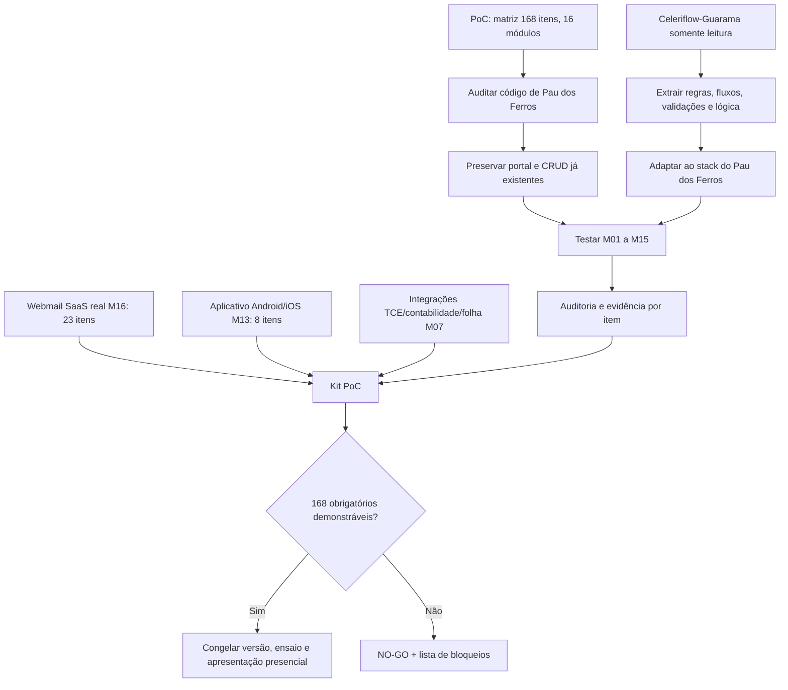

# MAPA ENXUTO — SOMENTE ENTREGA DA PoC PAU DOS FERROS
**22/10/2026 — escopo retificado.** O trabalho é exclusivamente a Prova de Conceito prevista no edital retificado, itens 1.1 a 16.23, sem implantação do contrato/atividades comerciais pós-vitória.

**Somente escrita no GitHub `Robonuvem-dev/pau-dos-ferros`, branch `Vette`**. Lovable não será acionado. Guarama pode ser estudado em leitura para transportar apenas as regras/funcionalidades necessárias a este repo.

## Ponto de partida real
- `main` de Pau dos Ferros: site + backoffice + Supabase/Drizzle + 27 cadastros/áreas + atendimento/e-SIC/Ouvidoria + painel ATRICON de 88 critérios. Commit “Finalizou Sprint 1 em uma etapa” (`fcfb0e6`), seguido do README `7f55ea0`.
- `Vette` criada sobre `main`, inicialmente com 3 commits de documentação. Nenhuma alteração funcional nossa até a auditoria de 22/10.
- Celeriflow-Guarama (somente leitura) contém código mais elaborado de transparência, licitações, RH, obras e frota. Stack incompatível para cópia direta: Next/Prisma/Firebase × TanStack/Supabase/Drizzle.
- **0/168 homologados** = testes individuais não feitos; NÃO significa ausência de todas as funcionalidades.

## Mapa de entrega

## Níveis de prioridade
**P0 — podem inviabilizar a demonstração:** webmail **M16**, aplicativo **M13**, integrações **M07**, autenticação/RLS e .env exposto; funcionamento real do backend e acesso público/admin.  
**P1 — aproveitar e provar:** M01/M02/M03/M04/M05/M08/M09/M10/M11/M12/M15; levar lógica de Guarama só onde a prova exigir.  
**P2 — restantes igualmente obrigatórios:** M06 COVID e M14 ATRICON, e detalhes restantes dos demais módulos; falso positivo ATRICON deve ser corrigido antes de qualquer veredito.

## Documentos de execução
1. [Checklist oficial de 168 itens](01_CHECKLIST_168_REQUISITOS.md) — cada item com evidência, nunca marcar por mera presença de CRUD.
2. [Plano de ataque de 0–48h](02_SPRINTS_ATE_POC.md) — blocos sobrepostos, adaptados à urgência.
3. [Raio-X do código e reuso da Celeriflow](03_RAIO_X_E_REUSO_CELERIFLOW.md) — evidências do GitHub e mapa por módulo.

## Requisitos da demonstração
- A comissão realiza a PoC presencialmente em até 2 dias úteis da convocação, com solução operacional existente, conta admin, dados de teste autorizados, equipamentos e conexão.
- Não pode haver desenvolvimento/customização da solução durante a demonstração.
- Requisitos precisam de **evidência em execução**, não PDF de intenção, wireframe, mockup ou cadastro vazio.
- Não executar deploy em `main` ou mexer no ambiente de produção sem autorização. O objetivo é deixar a `Vette` demonstrável e verificável.
- O edital previa sessão em 19/10/2026. Situação oficial de convocação/abertura precisa ser confirmada; não presumir que novo licitante ainda pode entrar.

## Próxima implementação de maior retorno
Três frentes simultâneas: 1) validar funcionalmente o que já está pronto no Pau dos Ferros, 2) portar regras puras da Celeriflow-Guarama estritamente necessárias ao edital, 3) desbloquear webmail/app/integrações. Se só houver um desenvolvedor, restringir estimativas e reconhecer NO-GO quando prazo inviável.
