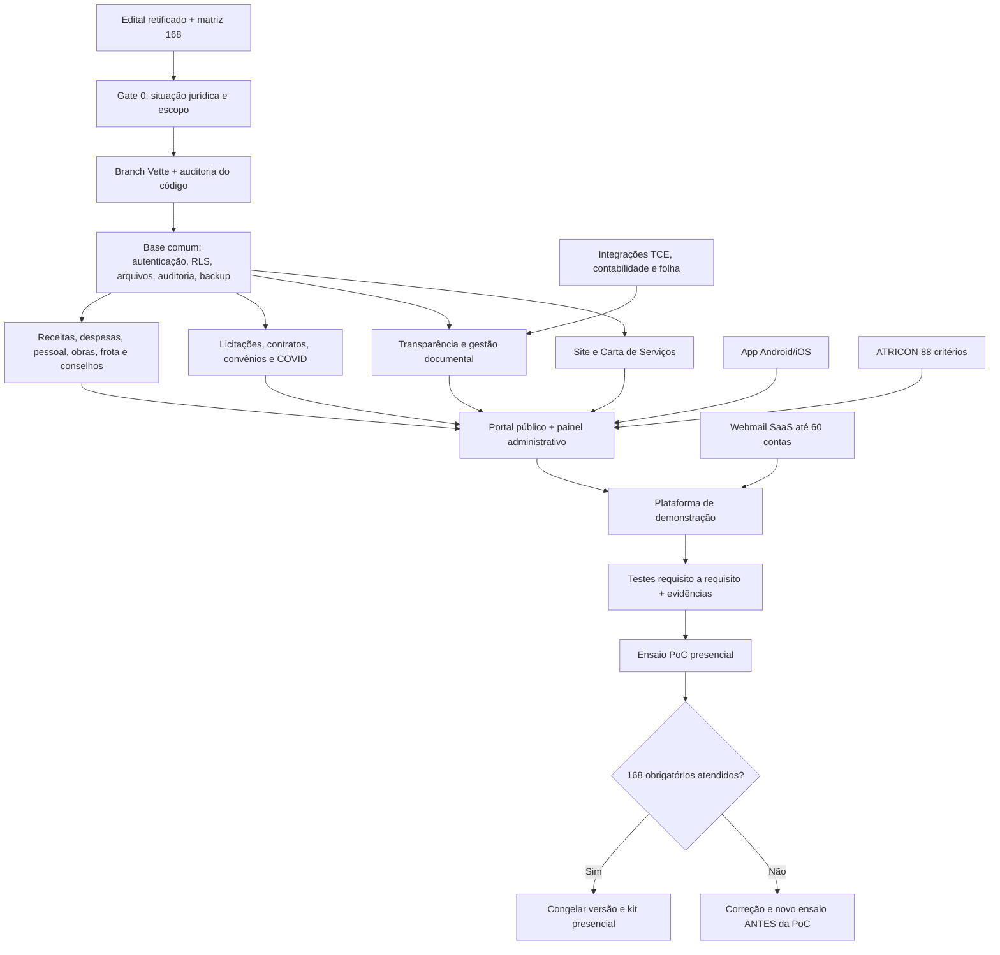

# Mapa executivo — entrega da PoC de Pau dos Ferros/RN

**Repositório exclusivo:** `Robonuvem-dev/pau-dos-ferros` · **Branch de desenvolvimento:** `Vette` · **Data-base:** 22/10/2026  
**Regra inegociável:** nenhuma alteração, gasto ou execução de IA no Lovable; nenhuma escrita em outros repositórios; sem alteração da `main` antes de validação e autorização. O GitHub é a única superfície de escrita deste plano.

## 1. Missão e limites

Entregar versão operacional demonstrável da solução integrada para **Portal Oficial**, **Portal da Transparência**, **informações institucionais** e **Webmail SaaS**, nos termos do **Pregão Eletrônico 6/2026-0036**, Processo Administrativo 16070301/2026, lote único, Prefeitura de Pau dos Ferros/RN.

Fonte primária: **edital retificado enviado pelo usuário** (60 páginas), especialmente **TR** e **Anexo I ao TR — Roteiro/Matriz da Prova de Conceito**, páginas 31 a 50. Valor referencial: R$ 74.376,84 / 12 meses, sujeito à disputa. A sessão do PDF estava marcada para **19/10/2026, 09h local**; a situação oficial atual, eventual suspensão, reabertura e participação **não estão confirmadas neste plano**. Agregadores consultados em 22/10 indicavam certame “encerrado”, mas isso NÃO substitui o andamento oficial.

**GATE 0 — decisão comercial/jurídica:** antes de prometer entrega a esta licitação específica, validar no Portal de Compras Públicas/PNCP: status e atas, possibilidade de convocação, data efetiva da sessão, exigência de habilitação, atestados e contrato. Se encerrado para novas propostas, o plano passa a ser **produto reutilizável**, sem presumir inscrição neste certame.

## 2. Regra de aceite da PoC

- Só a licitante provisoriamente classificada em primeiro lugar é convocada.
- Demonstração **presencial** em Pau dos Ferros/RN, no máximo **2 dias úteis após convocação** (TR 8.3–8.5); a comissão deve operar inclusive com credencial de administrador.
- A matriz contém **168 verificações em 16 módulos** e exige atendimento integral dos requisitos obrigatórios; não há pontuação parcial.
- É proibido desenvolver, alterar ou customizar requisitos faltantes durante a PoC.
- Devem estar disponíveis: equipamento, internet, ambiente operacional, usuários e senhas, dados fictícios/autorizados, anexos, exportações e evidências.
- Após contratação, o TR prevê **implantação em até 10 dias corridos**, **disponibilidade mensal 99,5%** e **treinamento inicial mínimo de 16 horas**; documentar suporte, backup, recuperação e exportação ao final do contrato. São obrigações posteriores **além da PoC**.

## 3. Mapa de arquitetura e de entregas

**A base do projeto já tem:** React/TanStack Start, Supabase/Drizzle, interface de portal, CRUD genérico, registros para notícias, licitações, contratos, convênios, receitas, despesas, servidores, obras, frota, conselhos, carta de serviços, e-SIC/Ouvidoria, gestão de usuários e análise ATRICON com 88 critérios. **Isso é observação de código, NÃO homologação funcional**.

### Matriz por workstream
| Módulo | Qtd. | Evidência identificada no código do repositório | Lacuna principal a examinar/desenvolver | Sprint |
|---|---:|---|---|---|
| 1. Infraestrutura | 5 | autenticação, banco Supabase e interface web | versionamento remoto, segurança, disponibilidade, administração | S0/S1 |
| 2. Site institucional | 14 | `src/lib/modules.ts`, `src/routes/index.tsx`, CRUD | Facebook, temas dinâmicos, unidades gestoras, alertas automáticos | S1 |
| 3. Licitações e contratos | 18 | cadastros públicos/administrativos | fluxo de fases, ARP/carona, aditivos relacionados, relatórios e alertas | S2 |
| 4. Convênios | 13 | cadastro básico `convenios` | metas, planos de aplicação, parcelas, vínculos e obrigações | S2 |
| 5. Portais/informações | 17 | `src/routes/esic.tsx`, notícias, consultas | prazos/recursos, dados em tempo real e acervo institucional completo | S1/S2 |
| 6. COVID-19 | 8 | categoria de documentos `covid` | vínculo semântico de despesas, contratos, pessoal, boletins e página dedicada | S2 |
| 7. Integrações | 3 | sem implementação completa comprovada | contratos de dados, importação contábil, folha e TCE, logs e mapeamentos | S3 |
| 8. LC 131 | 10 | tabelas de receitas/despesas agregadas | extraorçamentário, empenho→liquidação→pagamento, ordem bancária, medicamento | S3 |
| 9. Pessoal | 7 | cadastro `servidores` | importadores, descontos/vantagens, filtros e relatórios individualizados | S3 |
| 10. Obras | 13 | cadastro `obras` | processo de engenharia, medição, ART, vínculos, Plano Diretor e alertas | S4 |
| 11. Frotas | 4 | cadastro `veiculos` | campos obrigatórios, foto, alertas e pesquisa avançada | S4 |
| 12. Conselhos | 6 | cadastro `conselhos` | composição histórica, atas, documentos, páginas por conselho e alertas | S4 |
| 13. Aplicativo | 8 | não identificado app Android/iOS específico | publicação e edição autenticada pelo dispositivo, estatísticas e evidência móvel | S5 |
| 14. ATRICON | 4 | `src/lib/atricon.ts`, serviço de geração por IA | critérios rigorosos, evitar falso positivo, saída técnica verificável | S5 |
| 15. Carta de Serviços | 15 | `src/routes/servicos.tsx` e cadastro | etapas, responsável/Ouvidor, estatísticas, modelo e alertas | S1/S5 |
| 16. Webmail | 23 | roadmap original expressamente “sem webmail” | contratação/provisão de SaaS, domínio, 60 caixas, grupos, segurança, recuperação, auditoria | S0 (escolha) + S5 |
| **Total** | **168** | **presença de código ≠ aceite** | **cada critério precisa de prova real** | |

## 4. Mapa de riscos — críticos

1. **Prazo do pregão:** sessão prevista para 19/10 já passou; sem confirmação oficial, a PoC pode não estar ao alcance de novo licitante. Resolver no Gate 0.
2. **Webmail fora do produto atual:** 23 critérios, lote único. Decidir **desde S0** se fornecer por SaaS de terceiro permitido pelo edital, com licença/integração demonstrável; não fingir webmail com formulário mock.
3. **App Android/iOS:** acesso responsivo pelo navegador **não prova** automaticamente aplicativo Android/iOS. Confirmar formato exigido e demonstrar as oito operações.
4. **Integrações externas:** o município/fornecedores precisam fornecer esquema, amostras autorizadas, APIs ou arquivos; testar via sandbox/dados fictícios sem afirmar integração real onde não houver.
5. **ATRICON:** `avaliar()` atualmente pode tratar a existência de **um** cadastro como cumprimento de requisito; alterar para evidência específica e validação verificável.
6. **Exposição de segurança:** existe arquivo `.env` versionado na raiz; auditar **sem reproduzir segredos**. Se contiver tokens, revogá-los/rotacioná-los de modo autorizado. Avaliar também bootstrap do primeiro admin, permissões RLS e endpoint de consulta de protocolo.
7. **Divergência de dados e legislação:** fontes de receitas, folha, contas, diárias, atos legais e outros documentos devem ter origem real e rastreabilidade; exemplos fictícios sempre rotulados.
8. **Exportação incompleta:** consultas usam limite de 1.000 registros e exportação do subconjunto carregado; teste de paginação e exportação completa exigido conforme necessidade do requisito.
9. **Conexão com Lovable:** a branch `Vette` NÃO deve ser integrada à `main` por automação; nunca usar prompts, editor ou recursos de IA Lovable. Não alterar hospedagem paga sem autorização.

## 5. Política GitHub e qualidade

- Escritas SOMENTE em `Robonuvem-dev/pau-dos-ferros`, SOMENTE na branch `Vette`. `main` preservada; sem força-push/rebase destrutivo.
- Commits de escopo pequeno. Cada PR/commit deve citar requisitos (`Mxx / item x.y`), teste, evidência e impacto de segurança.
- Leitura de referências externas é permitida quando indispensável; **cópia ou escrita em outros repositórios é proibida**.
- Segredos, informações bancárias, cadastros pessoais e arquivos reais confidenciais **não entram no Git**.
- Executar lint, testes unitários/integrados e build **em ambiente de teste autorizado**, nunca executar migration contra produção sem autorização.
- Os planos são documentos versionados: alterações de requisito precisam registrar divergência do PDF e decisão correspondente.
- Para os 168 itens usar [Checklist](01_CHECKLIST_168_REQUISITOS.md); para sequência, responsáveis, riscos e Definition of Done usar [Sprints](02_SPRINTS_ATE_POC.md).

## 6. Gate final — autorização de PoC

**GO** somente se: status/convocação formal verificados, 168 obrigatórios com demonstração e evidência, autenticação/RLS seguros, webmail funcional, app demonstrável, integrações e licenças válidas, segunda revisão aprovada, kit presencial pronto. Qualquer ausência obrigatória => **NO-GO**, sem afirmar que a prefeitura concederá exceção.
